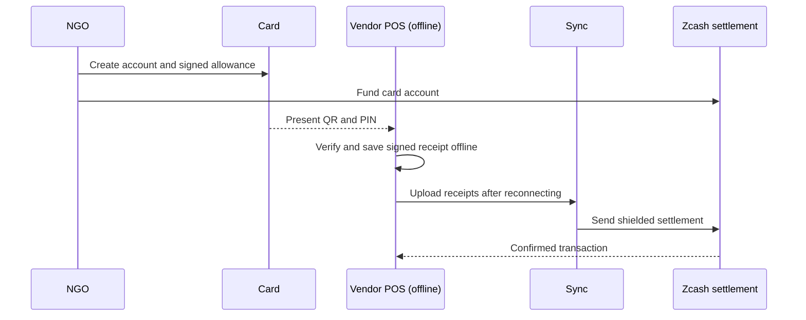

# ZecAid — offline aid allowance cards on Zcash

ZecAid gives families a private testnet allowance on Zcash that vendors can accept without a network connection.

## Demo

The narrated production demo is available at [docs/demo.mp4](docs/demo.mp4).

## The problem

Aid should remain usable when mobile coverage, power, or connectivity fails. Yet disconnected vendors cannot check a recipient’s current allowance or settle a payment privately. ZecAid lets vendors verify a printed allowance card offline, then settles signed receipts as shielded Zcash payments after reconnecting.

## How it works

1. An NGO opens a program and funds its Zcash testnet Treasury.
2. The NGO issues a card with its own shielded account, allowance, expiry, signed QR code, and one-time six-digit PIN.
3. A vendor pairs its POS while online and syncs the latest revocation and spending snapshot.
4. Offline, the POS verifies the card and PIN, checks the remaining allowance, and signs a local receipt.
5. On reconnection, the POS syncs receipts; the server checks them and sends real shielded settlements to the vendor.



## Real testnet evidence

These transactions were confirmed on Zcash testnet. Transaction IDs are shown in full so they can be checked independently.

| Action | Transaction ID | Mined height |
| --- | --- | ---: |
| Treasury funding | `c0c3e93f7093b4ac7f628340304bf248f2d4ff2f6658367aa8f4bfdd694e52e4` | 4549045 |
| Card funding | `45a85714f6df89b7b6e30a53f5d59f0634d88888e9542203dfeaa1b0cd2e7427` | 4549080 |
| Vendor settlement | `42b4f2915e17bd448194bd71d1a479dc233fbbe8a03d2885abad1bbe67b53a78` | 4549111 |
| Amina's household card funding | `cc85bf904bf3923150d70ba385bfe2670a75d2011d5de6b2e94d0fd1bed4b0cc` | 4549240 |
| Amina's household settlement | `059c6cddab6c9ad4e8964b436e89c914cea02782a9a44f44f9421853de3dec3e` | 4549253 |

## Features

- **NGO console:** treasury status, allowance cards, vendors, settlements, and audit statements from the real testnet wallet.
- **Offline vendor POS:** installable PWA, signed vendor receipts, offline PIN and allowance checks, and real settlements after sync.
- **Noir Wallet connect:** connect the browser extension and request a shielded payment to the Treasury.
- **Donor audit:** inspect account statements and explicitly reveal a unified full viewing key when sharing transaction history with a trusted auditor.

## Quickstart

1. Build `zcash-devtool` in its Rust source checkout:

   ```sh
   cargo build --release
   ```

2. In this repository, install dependencies and configure the binary if it is not on `PATH`:

   ```sh
   pnpm install
   export ZECAID_DEVTOOL_BIN="$HOME/zcash-devtool/target/release/zcash-devtool"
   pnpm dev
   ```

   The app runs at [http://127.0.0.1:43124](http://127.0.0.1:43124).

3. Open [http://127.0.0.1:43124/console](http://127.0.0.1:43124/console), choose **Open program**, then fund the displayed Treasury address with testnet ZEC. The console includes a QR and a [Fauzec](https://fauzec.com/) faucet link.

4. Issue a card, pair a vendor POS while online, and load `/pos` once to cache its shell and initial snapshot. After an offline charge, reconnect and sync the vendor receipts.

| Environment variable | Default | Purpose |
| --- | --- | --- |
| `ZECAID_DEVTOOL_BIN` | `zcash-devtool` from `PATH` | Zcash wallet command-line binary |
| `ZECAID_VAULT_DIR` | `./data/vault` | Local wallet and program vault; ignored by Git |
| `ZECAID_LIGHTWALLETD_SERVER` | `zecrocks` (`testnet.zec.rocks`) | Zcash testnet lightwalletd server |

## Trust model & limitations

- The NGO operates the self-hosted server and holds the Treasury and allowance-account keys in its local `data/vault`. Recipients do not hold wallet keys.
- The NGO signs each card’s allowance, expiry, and PIN verifier. The POS checks the signature, testnet, expiry, its last-synced revocation snapshot, remaining allowance, and PIN before storing a vendor-signed receipt.
- Offline POS devices cannot coordinate. A card may be presented to multiple disconnected vendors; at settlement, the server processes receipts in creation order, enforces the allowance, and rejects an overdraft. A freeze cannot undo an already-broadcast transaction.
- The six-digit PIN verifier is included in the QR payload. Scrypt (`N=2^14`, `r=8`, `p=1`) slows guesses, but someone with a copy of the QR can brute-force the PIN offline. Keep the card private and never write the PIN on it.
- Vendor signing keys live in the device’s IndexedDB and are not protected by a separate passphrase. A compromised device can sign receipts as that vendor.
- An explicitly revealed unified full viewing key exposes the account’s transaction history to its recipient. Share it only with a trusted accountant or auditor.
- The Noir Wallet testnet extension currently fails to sync with `invalid consensus branch id`; funding the Treasury from Noir Wallet is therefore untested. The Treasury QR remains available for deposits from another testnet wallet or via the faucet.
- `/pos` must first be loaded online to cache its shell and get a signed vendor snapshot. Later revocations are not visible until a device syncs.
- This is an unaudited testnet prototype. Testnet ZEC has no monetary value; the file-backed program store is for one self-hosted instance, not high availability. The console and APIs have no user authentication, so do not expose them to an untrusted public network.

## Tech stack

Next.js 16, React 19, TypeScript, Tailwind CSS 4, `zcash-devtool`, Zcash testnet lightwalletd, `@noble/ed25519`, scrypt, IndexedDB, service workers, `@zxing/browser`, `idb-keyval`, and `@noir-wallet/sdk`.

## License

MIT. See [LICENSE](LICENSE).
